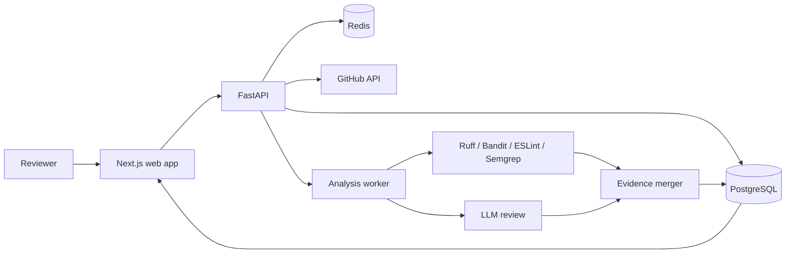

# Architecture

The API owns authorization, encrypted GitHub credentials, repository metadata, analyses, findings, and reviewer decisions. Workers clone repositories into temporary directories, redact secrets, run deterministic tools, then give the LLM only relevant excerpts and tool evidence. Temporary files are deleted after each job.

The current local MVP includes the full review data model, REST workflow, deterministic fallback scanner, seeded demo report, decision capture, and exports. GitHub OAuth, isolated worker execution, and a production LLM provider are explicit integration seams and require deployment credentials.
